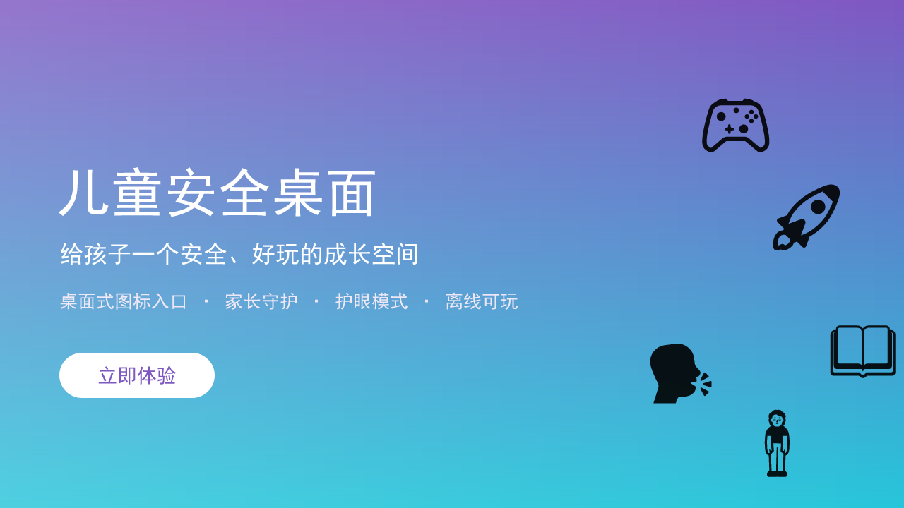
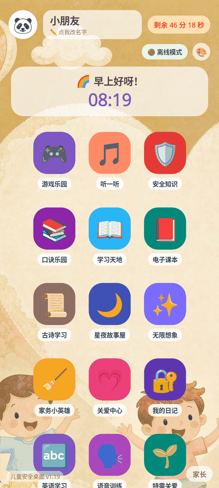
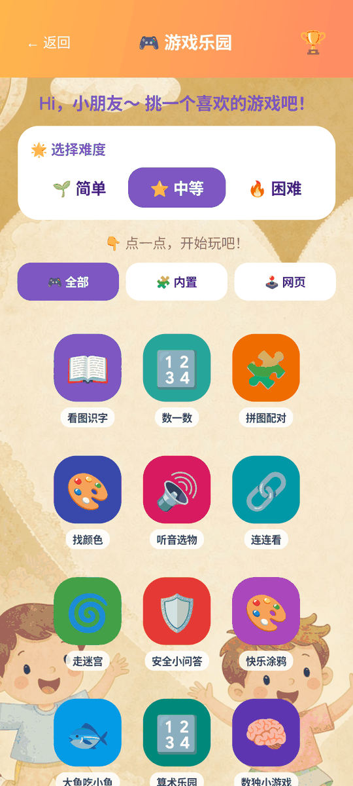
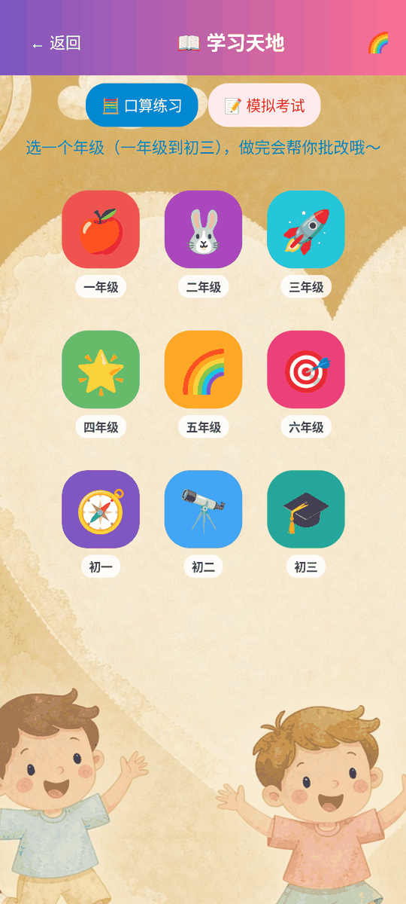
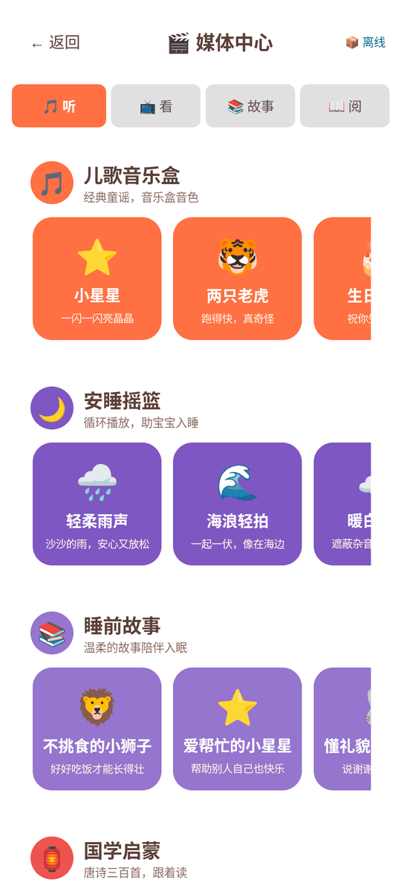
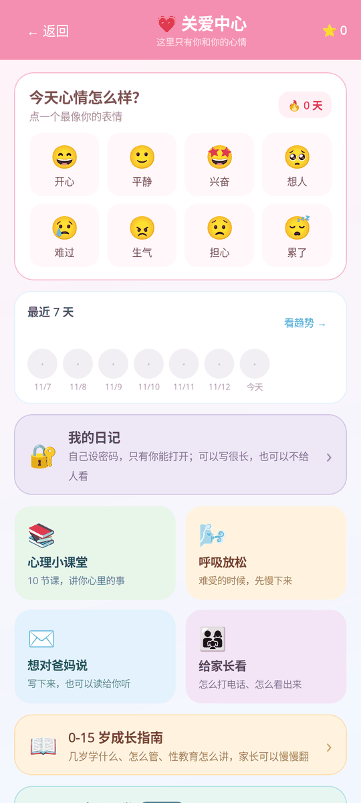

# Kids Safe Desktop

<p align="center">
  
</p>

<p align="center">
  
  
  
  
  
</p>

<p align="center">
  <b>English</b> · <a href="README.md">简体中文</a>
</p>

A **supervised desktop environment** for children aged 3–12. When a kid picks up the tablet or the family PC, they get a playful home screen with cartoons, songs, picture books, mini-games and study material — and nothing else: no browser, no short videos, no app store. Parents decide what is available and for how long, from a web console or a separate parent app.

Native client, **.NET 10 + .NET MAUI from a single codebase**, shipping Android, Windows and iOS (iPhone/iPad, content edition) from one set of sources; plus two independent front ends that do not reuse the XAML layer — **Linux** (Qt 6 + Kirigami, full-screen KDE Plasma session) and **HarmonyOS** (ArkTS + ArkUI). Everything works offline and depends on no cloud service; if you want remote management, you run a small ASP.NET Core server yourself.

> The iOS build is a **content edition**: picture books, songs, mini-games, mental arithmetic, the care centre and the parent PIN are all there; launcher replacement, app whitelisting and cross-app screen-time tracking rely on system capabilities iOS does not expose, so those are stubbed out. See [Docs/iOS上架说明.md](KidsSafeDesktop/Docs/iOS上架说明.md) (Chinese) for the boundary table, build and App Store checklist.

> Current versions: client **v1.20** (versionCode 21), server **1.4.1**. See the [changelog](KidsSafeDesktop/Docs/更新记录.md) (Chinese).

---

## Contents

- [Why this exists](#why-this-exists)
- [Screenshots](#screenshots)
- [Features](#features)
- [Website and feedback](#website-and-feedback)
- [Architecture](#architecture)
- [Getting started](#getting-started)
- [Configuration and secrets](#configuration-and-secrets)
- [Repository layout](#repository-layout)
- [Documentation](#documentation)
- [Known limitations](#known-limitations)
- [Roadmap](#roadmap)
- [Contributing](#contributing)
- [License and disclaimer](#license-and-disclaimer)

---

## Why this exists

Handing a device to a child is rarely a question of "is there a kids mode". The real problems are that kids modes are easy to bypass, or so barren that the child refuses to use them. This project sits in between:

- **Kids actually want to use it** — 21 native mini-games, 15 bundled web games, an offline audio centre, picture books, textbooks, mental arithmetic drills, drawing, stars and leaderboards. Not an empty allowlist.
- **Parents stay in control** — app allowlist, daily time limits, per-game switches, a blue-light filter, and a master switch for online content. Leaving kids mode requires the parent PIN; on Windows the app also hides the taskbar and swallows Win / Alt+Tab / Ctrl+Esc / Alt+F4.
- **Data stays on the device** — scores, diary entries, mood logs and usage time live locally (`SecureStorage` / SQLite / JSON). The only network calls are weather (can be turned off) and the optional parent server. AI story generation is off by default and needs the parent to opt in with their own key.
- **No account required** — a local account is created on first launch, so the app is usable offline out of the box. A self-hosted server is only needed for cross-device management.

## Screenshots

All five are real Android screenshots of v1.19 / v1.20 — no mockups. Tap to open the full image on mobile:

<p align="center">
  
  
  
</p>

<p align="center"><strong>Home · Games · Study</strong></p>

<p align="center">
  
  
</p>

<p align="center"><strong>Listen · Media · Care Center</strong> (more on the <a href="https://kids.siguangblog.cc/">website</a>)</p>

> The website and this README share the same files in `KidsSafeDesktop/Website/assets/`; the header image `header.png` is stitched from the same three real screenshots.

## Features

### Kids' app (KidsSafeDesktop)

| Module | What's inside |
|---|---|
| Home screen | Icon grid (wrapping on Windows, paged carousel on phones), themes, hourly weather with locally derived alerts, launch animation, eye-care badge |
| Mini-games | 21 native games: arithmetic, sudoku, Go, Tetris, mazes, colour hunt, whack-a-mole, typing, balloons, sound matching, character and pinyin recognition, picture-to-word, safety quiz, trivia, mind reading… all sharing one difficulty and leaderboard system |
| Game arcade | 15 complete web games bundled as-is (space shooter, gomoku, snake, match-3, Chinese chess, animal chess, poetry puzzle…), playable offline |
| Listen (offline audio) | Nursery rhymes, sleep sounds (rain / waves / white noise), bedtime stories, Chinese classics, English basics, science snippets; native player with sentence-by-sentence highlighting |
| Reading | Story house, picture books, classical poetry, textbook shelf (bring your own files), article reader |
| Study | Grade 1–9 mental arithmetic with auto-marking (grades 5–9 draw from a SQLite question bank), score reports, mistake review, Chinese TTS reading the questions aloud |
| English | Grade- and topic-based flashcards plus a quiz mode, phonetics and English TTS |
| Care centre | Mood check-in with a 7-day trend, PIN-locked diary, 10 psychology lessons, breathing exercise, "a letter to mum and dad", 10 parent lessons, 0–15 age guide, depression information pages, and **where to find picture books** (three free and legal sources, five classics worth starting with, and why "600-book collections" floating around on file-sharing sites are a copyright risk) |
| Safety and health | Safety knowledge (traffic, fire, strangers, drowning), safety quiz, eye exercises, body encyclopedia |
| Motivation | Stars, badge wall, streaks, leaderboards |
| Parent entry | 4-digit PIN gate to the local parent console, where every setting can be changed |

### Parent app (KidsSafeParent, standalone)

Same parent console, different entry point: it launches straight into the parent area (still behind the PIN) without loading the kids shell.

- Daily time limits and allowed hours; app allowlist (enumerates installed applications)
- Per-game switches, theme, eye-care mode (strength and schedule), master switch for online content
- Growth guide, parent lessons, guides for special-needs training
- Connect to the parent server: enter an address plus account credentials or a 6-digit pairing code to push settings remotely

### Server (KidsSafeServer, optional)

| Capability | Notes |
|---|---|
| Parent accounts | Username + password (PBKDF2-SHA256, 100k iterations, 16-byte salt), HMAC-signed tokens |
| Device pairing | 6-digit code, valid for 10 minutes, single use; device tokens are **read-only** — writes return 403 |
| Per-account isolation | One `data/profiles/{accountId}.json` per account, so one server can serve several families |
| Live push | Long polling on `/api/watch`; a save on the parent side reaches the child device in about a second, without WebSockets or vendor push SDKs |
| Content and releases | Changelog, installer listing, content manifests, story proxy (third-party keys stay server-side) |

## Website and feedback

The official site, <https://kids.siguangblog.cc/>, is just `KidsSafeDesktop/Website/` — plain static files that run on Nginx, GitHub Pages or an object store. Four of its pages talk to `/api/feedback/*` on the server:

| Page | Purpose | Data source |
|---|---|---|
| `comments.html` | Public comment wall: post in place, filter by platform and rating, like, load more | 14 curated entries in `Website/data/comments.json` (edit the file, the page follows) merged with live server comments, de-duplicated by body text |
| `feedback.html` | Feedback form, satisfaction survey and usage questionnaire in one page, with live public stats beside it | Same store; shows three featured quotes |
| `feedback-admin.html` | Full listing and CSV export | Requires `Feedback:AdminKey` |
| `care-sources.html` | Every source the care centre cites: 22 references, each one clickable | Maintained by hand |

Deliberate choices: nicknames are optional and **IPs are counted, never stored** (10 minutes / 12 posts, 24 hours / 60); **likes live only in the browser**, so no account system had to be invented for a counter; posting is optimistic — a successful POST is inserted immediately and marked "just posted", while offline posts queue in `localStorage`; curated entries always sort ahead of new ones.

See **[Docs/用户反馈与问卷.md](KidsSafeDesktop/Docs/用户反馈与问卷.md)** for the client entry points and API contract, and **[Docs/官网运维清单.md](KidsSafeDesktop/Docs/官网运维清单.md)** for the two Nginx proxy blocks (`/api/`, `/patches/`).

## Architecture

```
┌──────────────────────────────┐        ┌──────────────────────────────┐
│  KidsSafeDesktop             │        │  KidsSafeParent              │
│  kids' app                   │        │  parent app                  │
│  shell + platform services   │        │  shell + stub services       │
└──────────────┬───────────────┘        └──────────────┬───────────────┘
               │          ProjectReference             │
               └──────────────────┬────────────────────┘
                                  ▼
              ┌───────────────────┬──────────────────┐
              │  KidsSafeShared (class library)      │
              │  Pages / ViewModels / Services       │
              │  Models / Helpers / Controls         │
              │  Converters (namespace is still      │
              │  KidsSafeDesktop.*, see below)       │
              └──────────────────┬───────────────────┘
                                 │ HTTP (optional, LAN)
                                  ▼
              ┌───────────────────┬──────────────────┐
              │  KidsSafeServer (ASP.NET Core)       │
              │  Minimal API + static parent console │
              │  JSON files under data/              │
              └──────────────────────────────────────┘
```

All three client projects use the `KidsSafeDesktop.*` namespace. When the parent app was split out, keeping the original namespace meant 340+ files did not need a single `using` change. **New code should keep using it.**

## Getting started

### Requirements

| Dependency | Version | Notes |
|---|---|---|
| .NET SDK | 10.0.100+ | Developed on `10.0.401` |
| MAUI workloads | `maui` | Installs both Android and Windows; see the command below |
| Android SDK | API 36 platform, API 21 minimum | Not needed if you only build for Windows |
| Windows | 10 1809 (`10.0.17763`) or later | Required by the Windows App SDK |

First-time workload install (use `maui-android` or `maui-windows` if you only need one platform):

```bash
dotnet workload install maui
```

### Build the Windows apps

```bash
git clone https://github.com/<you>/KidsSafeDesktop.git
cd KidsSafeDesktop

# Kids' app
dotnet build KidsSafeDesktop/KidsSafeDesktop.csproj -f net10.0-windows10.0.19041.0

# Parent app
dotnet build KidsSafeParent/KidsSafeParent.csproj -f net10.0-windows10.0.19041.0
```

> **Always pass `-f`.** The projects are multi-targeted (`net10.0-android` plus Windows); without it, restore also pulls Android and fails with errors such as `NU1102` when no Android SDK is installed.

Run it:

```bash
dotnet run --project KidsSafeDesktop/KidsSafeDesktop.csproj -f net10.0-windows10.0.19041.0
```

First launch walks through: privacy consent → splash animation → a four-step wizard (4-digit parent PIN, child's name and avatar, daily time limit, and the anti-exit permission on Android only), then the home screen.

### Build for Android

```bash
dotnet build KidsSafeDesktop/KidsSafeDesktop.csproj -f net10.0-android
# APK output: KidsSafeDesktop/bin/Debug/net10.0-android/*-Signed.apk
```

Signing is covered in [Configuration and secrets](#configuration-and-secrets). For a quick phone install, the debug signature is enough.

### Build for iOS

Full signing and App Store steps: [Docs/iOS上架说明.md](KidsSafeDesktop/Docs/iOS上架说明.md) (Chinese).

```bash
# Windows: compile check only (no .app bundle, Xcode is required for that)
dotnet build KidsSafeDesktop/KidsSafeDesktop.csproj -f net10.0-ios -p:EnableIosTarget=true

# macOS (Xcode 16+, dotnet workload install ios maui)
bash KidsSafeDesktop/Scripts/build-ios.sh sim    # simulator
bash KidsSafeDesktop/Scripts/build-ios.sh ipa    # release ipa, see Signing.iOS.props.sample
```

> The iOS target is only part of `TargetFrameworks` on macOS (`IsOSPlatform('osx')`), or when `-p:EnableIosTarget=true` is passed. Regular Windows builds are unaffected.

### Run the server (optional)

```bash
cd KidsSafeServer
cp appsettings.sample.json appsettings.json   # at minimum, change AdminPin
dotnet run
```

Listens on `http://0.0.0.0:5180` (the port is set at the end of `Program.cs` and can be overridden with the `KS_URLS` environment variable).

1. Open `http://localhost:5180` — with no accounts yet you land on the registration page; the first account is the owner
2. In the console, open **Account & devices** → generate a 6-digit pairing code
3. On the child device: parent console → enter `http://<LAN-IP>:5180` as the server address and the pairing code as the credential

## Configuration and secrets

This repository contains **no real secrets**. The files below are excluded by `.gitignore` and must be created locally. Without them the projects still build and run; the related feature is simply unavailable. (The `KidsSafeDesktop/` prefix is dropped to keep the lines narrow.)

- **`KidsSafeServer/appsettings.json`** — admin PIN, third-party story API key.
  Copy from `appsettings.sample.json`; without it the story proxy stops working, everything else is fine.
- **`Signing.props`** — Android keystore alias and passwords.
  Copy from `Signing.props.sample`; without it Android builds are unsigned.
- **`Keys/kidssafe.keystore`** — Android signing certificate; create your own, command below.
- **`Platforms/Android/Assets/mcs-services.json`** — Honor Push configuration.
  Delete it if you don't need push, and remove the matching `AndroidAsset` line from the csproj.
- **`Platforms/Android/libs/*.aar`** — Honor Push Kit SDK.
  Download from the [Honor developer portal](https://developer.honor.com/) yourself — **do not commit it**, the licence is not open source.

Generate the templates and a signing certificate:

```bash
cp KidsSafeServer/appsettings.sample.json KidsSafeServer/appsettings.json
cp KidsSafeDesktop/Signing.props.sample KidsSafeDesktop/Signing.props

keytool -genkeypair -alias kidssafe -keyalg RSA -keysize 2048 \
  -validity 10000 -keystore KidsSafeDesktop/Keys/kidssafe.keystore
```

> ⚠️ Changing `ApplicationId` has consequences: on Android a new package name is a different app, so existing installs cannot be upgraded in place. On Windows the project uses `WindowsPackageType=None` and ships through an installer rather than MSIX.

**Behaviour without keys**: the story proxy returns an error payload and the client falls back to bundled stories; weather uses the public Open-Meteo API, which needs no key but can be switched off by a parent.

## Repository layout

```
.
├── KidsSafeDesktop/          Kids' app (shell + platform code + assets + website + scripts)
│   ├── Platforms/            Android: MainActivity / kids mode / Honor push; Windows: WinUI entry, app catalog
│   ├── Resources/            Images, fonts, bundled web pages and audio, icons, splash
│   ├── Website/              Static website and changelog (deploy anywhere)
│   ├── Scripts/              Release, deploy, privacy export, PDF-to-image tooling
│   ├── Installer/            Inno Setup script
│   ├── Linux/                KDE Plasma front end (Qt 6 + Kirigami, independent of MAUI)
│   ├── Harmony/              HarmonyOS front end (ArkTS + ArkUI, independent of MAUI)
│   ├── Baby36Server/         Local companion server for the "36 stratagems" role-play game (Node built-ins only)
│   └── Docs/                 Design and technical docs, changelog, store material
├── KidsSafeShared/           Shared library: every page, view model, service, model, control
├── KidsSafeParent/           Parent app (separate shell, reuses the shared library)
├── KidsSafeServer/           ASP.NET Core parent management server
│   ├── Auth/                 Accounts, password hashing, tokens, pairing codes
│   ├── wwwroot/              Parent console, login page, docs, download page
│   └── data/                 Created at runtime (accounts, token key, per-account profiles), not committed
├── LICENSE
└── README.md
```

## Documentation

The docs are written in Chinese; the two engineering notes below are the ones worth reading first even through a translator.

| Document | Contents |
|---|---|
| [Docs/设计文档.md](KidsSafeDesktop/Docs/设计文档.md) | Product positioning, user scenarios, design trade-offs behind 25 capabilities |
| [Docs/技术文档.md](KidsSafeDesktop/Docs/技术文档.md) | Stack and key implementations (weather and geolocation, blue-light filter, TTS, screen-time guard) |
| [Docs/工程结构-家长端拆分.md](KidsSafeDesktop/Docs/工程结构-家长端拆分.md) | Conventions and pitfalls of the three-project split |
| [Docs/账号体系.md](KidsSafeDesktop/Docs/账号体系.md) | Accounts, pairing codes, tokens and the migration path |
| [Docs/实时下发通道.md](KidsSafeDesktop/Docs/实时下发通道.md) | Long-polling version numbers and reconnect strategy |
| [Docs/更新记录.md](KidsSafeDesktop/Docs/更新记录.md) | Version-by-version changelog (client and server) |
| [Docs/用户反馈与问卷.md](KidsSafeDesktop/Docs/用户反馈与问卷.md) | Feedback pages, API contract, offline queue, privacy boundaries, acceptance steps |
| [Docs/官网运维清单.md](KidsSafeDesktop/Docs/官网运维清单.md) | Post-launch operations: Nginx proxying, caching, backups |
| [KidsSafeServer/wwwroot/docs.html](KidsSafeServer/wwwroot/docs.html) | Deployment and troubleshooting guide for parents |

## Known limitations

These are real boundaries, not roadmap prose:

- **Android and Windows are the primary targets** (one MAUI codebase). **iOS is wired up and compiles cleanly** (`net10.0-ios`, including native audio playback, sound effects, the eye-care overlay and the privacy manifest), but it has **not yet been run on a device or simulator** — signing and App Store submission need a Mac plus an Apple Developer account. Windows can only do a compile check: `dotnet build -f net10.0-ios` plus `-p:EnableIosTarget=true`.
- **Linux and HarmonyOS are separate front ends** (`KidsSafeDesktop/Linux/`, Qt 6 + Kirigami; `KidsSafeDesktop/Harmony/`, ArkTS + ArkUI). Neither reuses the XAML layer, their feature sets are not identical to the desktop app, and neither was regression-tested for this release — each folder's README lists the differences.
- **The server has no TLS and no rate limiting of its own.** It binds to `127.0.0.1:5180`; public access must sit behind a TLS reverse proxy (the official site does exactly that, proxying `/api/*` and passing `X-Forwarded-For` through). **Do not port-forward 5180 to the internet.**
- **The parent app has no icon or release script of its own yet**, and its `ApplicationId` is a placeholder (`com.companyname.kidssafeparent`) that must be changed before packaging.
- **Textbook PDFs are not distributed with this repository.** The 130 textbooks under `KidsSafeServer/wwwroot/books/` are copyrighted by their publishers; only the catalogue metadata is kept. Without the files the shelf is empty.
- **Content licensing.** Nursery rhymes and white noise are synthesised in-project; stories and picture books are original or adapted from public-domain material; poetry is public domain. Check `Docs/第三方SDK清单.md` before any commercial use.
- **AI stories are off by default** and require an OpenAI-compatible key (DeepSeek, Huawei Cloud MaaS, etc.). Enabling it means the child's input leaves the device.
- **Mobile gestures and pairing-code entry were only verified in desktop browsers and at simulated viewport sizes**, not on physical devices.

## Roadmap

- [ ] Dedicated icon, version and one-command packaging for the parent app
- [ ] A full regression pass on the Linux and HarmonyOS front ends, closing the gaps with the desktop app
- [ ] Merge settings across both apps (server and client live sync exist; a full conflict-merge strategy does not)
- [ ] Multiple child profiles per account, each with its own time limits and content
- [ ] Replace textbook PDFs with openly licensed material to remove the copyright dependency
- [ ] iOS device/simulator regression, signing and App Store submission (the project itself is done); screen-time APIs (FamilyControls) and Singular attribution on iOS come later
- [ ] Server: password recovery, audit log, optional self-signed HTTPS mode

## Contributing

Issues and pull requests are welcome. Before submitting:

1. `dotnet build` all four projects with zero errors (for shared-library changes, build both apps, for both Windows and Android);
2. never commit `appsettings.json`, `Signing.props`, `*.keystore` or `mcs-services.json`;
3. keep the `KidsSafeDesktop.*` namespace for new pages, and register any new service in both apps' `MauiProgram`;
4. attach screenshots for UI changes (one Android portrait, one Windows).

There is no enforced toolchain. Follow the surrounding files: **comments in Chinese, and `/// <summary>` blocks that explain *why* rather than *what***. Those comments are the most valuable part of this repository — please preserve them.

## License and disclaimer

Released under the [MIT License](LICENSE): use it, modify it, ship it commercially, keep the copyright notice.

A few things to keep in mind:

- This is a **parenting aid**, not a substitute for supervision. Every kids mode can be bypassed (reinstall, reflash, external keyboard). Treat it as raising the cost, not as an absolute lock.
- The psychological content in the care centre is informational only and **is not a medical diagnosis**. If a child shows persistent difficulties, seek professional help.
- The repository ships no copyrighted textbooks, commercial fonts or push SDKs. Content you add yourself is your own licensing responsibility.
- The project is not affiliated with, or endorsed by, any device vendor or content platform.
